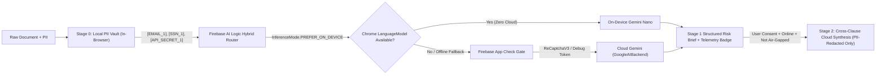

# LocalShield — HybridDoc Brief

**Privacy-first contract, privacy-policy, and technical document risk analyzer powered by Firebase AI Logic Hybrid Inference (`InferenceMode.PREFER_ON_DEVICE`), Chrome Gemini Nano, and Firebase App Check.**

Built for **#BuildHybridAI 2026** (Web / Chrome track).

## Why LocalShield?

Legal teams, founders, and engineers routinely paste sensitive MSAs, NDAs, DPAs, and vendor policies into cloud LLMs—exposing emails, tax IDs, payment cards, IBANs, IP addresses, and live API secrets.

LocalShield solves this with a **three-stage zero-leakage hybrid pipeline**:

1. **Stage 0 — Deterministic Local PII Vault (0 bytes leave browser):** Masks emails, phone numbers, SSNs, credit cards, IBANs, IPv4 addresses, street addresses, and API tokens (`sk-...`, `AIza...`, `ghp_...`) locally in-memory before any prompt is constructed.
2. **Stage 1 — On-Device Triage (`InferenceMode.PREFER_ON_DEVICE`):** Uses Firebase AI Logic (`firebase/ai`) to run structured clause extraction and redline counter-proposals **on-device via Chrome's Gemini Nano Prompt API** when available, with automatic fallback to cloud Gemini (`gemini-2.5-flash`) when Gemini Nano is unavailable.
3. **Stage 2 — App Check-Protected Cloud Escalation (PII-Redacted Only):** Optionally escalates the **PII-redacted** document to Cloud Gemini via `GoogleAIBackend` (guarded by **Firebase App Check**) for deep cross-clause contradiction detection and compliance gap synthesis. Blocked automatically in Air-Gapped (`ONLY_ON_DEVICE`) or offline mode.

## Architecture



## Quick Start

### 1. Install Dependencies

```bash
npm install
```

### 2. Configure Firebase Environment Variables

Copy `.env.example` to `.env` (never commit `.env` or real keys):

```bash
cp .env.example .env
```

Fill in your Firebase Web App config from **Firebase Console -> Project Settings -> Your apps** and enable **Firebase AI Logic** (Gemini Developer API) in the Firebase Console:

- `VITE_FIREBASE_API_KEY`
- `VITE_FIREBASE_AUTH_DOMAIN`
- `VITE_FIREBASE_PROJECT_ID`
- `VITE_FIREBASE_STORAGE_BUCKET`
- `VITE_FIREBASE_MESSAGING_SENDER_ID`
- `VITE_FIREBASE_APP_ID`
- `VITE_FIREBASE_CLOUD_MODEL=gemini-2.5-flash`

> **No `.env` yet?** The app runs out-of-the-box in clearly labeled **Sandbox Mode** using the local deterministic PII vault and analyzer so you can inspect the telemetry state machine immediately.

### 3. Enable Firebase App Check (Debug Token or reCAPTCHA v3)

For local development:

1. Keep `VITE_APPCHECK_DEBUG_TOKEN=true` in `.env` and supply your reCAPTCHA v3 site key in `VITE_APPCHECK_RECAPTCHA_SITE_KEY` (registered under **Firebase Console -> App Check -> Apps**).
2. Open browser DevTools Console on first run, copy the logged App Check debug token UUID, and register it under **App Check -> Apps -> Manage debug tokens** in Firebase Console.
3. Optionally set `VITE_APPCHECK_LIMITED_USE=true` to pass `useLimitedUseAppCheckTokens: true` into `getAI()`.

### 4. Enable Chrome Gemini Nano (On-Device Prompt API)

To run Stage 1 100% on-device in Chrome (138+ / Dev / Canary):

1. Open `chrome://flags/#optimization-guide-on-device-model` and set to **Enabled BypassPerfRequirement**.
2. Open `chrome://flags/#prompt-api-for-gemini-nano` and set to **Enabled**.
3. Relaunch Chrome and open `chrome://on-device-internals` to verify model readiness, or click **Warm Up Nano** inside LocalShield (calls `generativeModel.initializeDeviceModel(onDownloadProgress)`).

### 5. Run Locally, Test, and Build

```bash
npm run dev        # Start Vite dev server
npm run typecheck  # Strict TypeScript check (tsc --noEmit)
npm test           # Run offline Vitest suite (zero outbound network calls)
npm run build      # Production build (dist/)
```

## Verified Firebase SDK Integration (`firebase@^13.4.0`)

- `firebase/app`: `initializeApp`, `getApps`, `getApp`
- `firebase/app-check`: `initializeAppCheck`, `ReCaptchaV3Provider`, `getToken`
- `firebase/ai`: `getAI`, `GoogleAIBackend`, `getGenerativeModel`, `InferenceMode`, `InferenceSource`, `Schema`

## License

Apache License 2.0 — see [LICENSE](LICENSE).
