# LocalShield — HybridDoc Brief

**Offline-first, zero-leakage contract, privacy-policy, and technical document risk analyzer powered by Firebase AI Logic Hybrid Inference (`InferenceMode.PREFER_ON_DEVICE` & `ONLY_ON_DEVICE`), Chrome Gemini Nano, and Firebase App Check.**

Built for **#BuildHybridAI 2026** (Web / Chrome PWA + Chrome Side-Panel Extension).

## Why LocalShield?

Legal reviewers, founders, and engineers routinely paste sensitive MSAs, NDAs, DPAs, and vendor policies into cloud LLMs—exposing emails, SSNs, EINs, payment cards, IBANs, IP addresses, JWTs, AWS keys, and live API secrets.

LocalShield eliminates raw data egress with a **four-stage zero-leakage hybrid pipeline**:

1. **Stage 0 — Deterministic Local PII Vault (0 bytes leave browser):** Masks `API_SECRET`, `AWS_KEY`, `JWT`, `SSN`, `EIN`, Luhn-validated `CARD`, `IBAN`, `EMAIL`, `PHONE`, `IPV4`, `ADDRESS`, and user-defined **Custom Confidential Terms** (`CUSTOM`) in browser memory before any prompt is built.
2. **Stage 0.5 — Optional On-Device Semantic PII Scrub (`InferenceMode.ONLY_ON_DEVICE`):** Runs strictly on-device via Chrome Gemini Nano to mask unstructured `PERSON`, `ORG`, and `CODENAME` entities locally without ever touching a cloud endpoint.
3. **Stage 1 — On-Device First Triage (`InferenceMode.PREFER_ON_DEVICE`):** Uses `firebase/ai` (`generateContentStream()`, `AbortController`, and `countTokens()` chunking with map-reduce merge) to extract risky clauses, severity ratings, and redline counter-proposals on-device via Chrome Gemini Nano, falling back cleanly to Cloud Gemini (`gemini-3-flash-preview`) or the offline deterministic heuristic analyzer.
4. **Stage 2 — App Check-Guarded Cloud Escalation & Interactive Negotiation (PII-Redacted Only):** Escalates only the **PII-redacted** document to Cloud Gemini via `GoogleAIBackend` (protected by **Firebase App Check**) for cross-clause contradiction synthesis, a live **Stage 1 vs. Stage 2 Delta** breakdown, and per-clause multi-turn `startChat()` negotiation. Automatically blocked in `ONLY_ON_DEVICE` or offline mode.

## Key Capabilities

- **Local Document & Multimodal Ingestion:** Client-side `.pdf` extraction (bundled local `pdfjs-dist` worker), `.docx` parsing (`mammoth`), `.txt`/`.md`, and scanned image attachments (`.png`, `.jpg`, `.webp`) processed in-browser with zero upload to a backend server.
- **Interactive Redline Workbench:** Severity distribution bar with clickable filter pills (`All`, `Critical`, `High`, `Medium`, `Low`), Accept/Reject/Edit redline controls per clause, live compiled **Contract Diff View**, optional browser-only **Local Vault Restore** for final export, and Markdown / Print-PDF export.
- **Live Hybrid Telemetry & Judge Onboarding:** Combined Stage 1 + Stage 2 latency (`ms`) and token telemetry with per-stage breakdown, live `ON-DEVICE` / `CLOUD FALLBACK` / `CLOUD ESCALATION` / `LOCAL HEURISTIC` badges, Firebase App Check token verification, and an inline 30-second **Enable Gemini Nano** guide with one-click flag copy and live **Re-probe Nano** (no reload required).
- **Offline-First PWA & Redacted Local History:** Installable Web App (`public/manifest.webmanifest`, `public/sw.js`) that reloads offline in airplane mode, paired with IndexedDB scan history storing only PII-redacted payloads (zero raw secrets persisted to disk).
- **Chrome Side-Panel Extension:** Dedicated Manifest V3 extension sharing `src/lib/*` to audit any live Terms of Service or Privacy Policy tab in one click.

## Architecture

```mermaid
flowchart LR
    Doc["Raw PDF / DOCX / Text / Image"] --> Stage0["Stage 0: Deterministic Local PII Vault (Luhn, AWS, JWT, EIN, Custom)"]
    Stage0 --> Stage05["Stage 0.5: On-Device Semantic PII (ONLY_ON_DEVICE: PERSON/ORG/CODENAME)"]
    Stage05 -->|"[EMAIL_1], [AWS_KEY_1], [CUSTOM_1]"| Router["Firebase AI Logic Hybrid Router (Streaming + Chunking)"]
    Router -->|"InferenceMode.PREFER_ON_DEVICE"| NanoCheck{"Chrome Gemini Nano Ready?"}
    NanoCheck -->|"Yes (Zero Cloud)"| Nano["On-Device Gemini Nano"]
    NanoCheck -->|"No / Fallback"| CloudGate["Firebase App Check Gate"]
    CloudGate -->|"ReCaptchaEnterprise / V3 / Debug"| Cloud["Cloud Gemini (GoogleAIBackend)"]
    Nano --> Stage1["Stage 1 Risk Brief + Severity Filter + Telemetry"]
    Cloud --> Stage1
    Stage1 -->|"Online + Not Air-Gapped"| Stage2["Stage 2: Redacted Cloud Escalation + S1/S2 Delta + startChat() Negotiation"]
    Stage2 --> Export["Redline Diff + Local Vault Restore + Markdown/PDF + IndexedDB History"]
```



## Quick Start

### 1. Install Dependencies

```bash
npm install
```

### 2. Configure Firebase Environment Variables

Copy `.env.example` to `.env` (never commit `.env` or real keys):

```bash
cp .env.example .env
```

Fill in your Firebase Web App config from **Firebase Console -> Project Settings -> Your apps** and enable **Firebase AI Logic** (Gemini Developer API):

- `VITE_FIREBASE_API_KEY`
- `VITE_FIREBASE_AUTH_DOMAIN`
- `VITE_FIREBASE_PROJECT_ID`
- `VITE_FIREBASE_STORAGE_BUCKET`
- `VITE_FIREBASE_MESSAGING_SENDER_ID`
- `VITE_FIREBASE_APP_ID`
- `VITE_FIREBASE_CLOUD_MODEL=gemini-3-flash-preview`
- `VITE_APPCHECK_PROVIDER=recaptcha-enterprise` (or `recaptcha-v3`)
- `VITE_APPCHECK_RECAPTCHA_SITE_KEY`

> **No `.env` yet?** LocalShield runs out-of-the-box in clearly labeled **Sandbox Mode** using the local deterministic PII vault and analyzer so you can inspect the full hybrid state machine with zero cloud quota spent.

### 3. Enable Chrome Gemini Nano (On-Device Prompt API)

To run Stage 0.5 and Stage 1 100% on-device in Chrome 138+ (Desktop):

1. Open `chrome://flags/#optimization-guide-on-device-model` -> set to **Enabled BypassPerfRequirement**.
2. Open `chrome://flags/#prompt-api-for-gemini-nano` -> set to **Enabled**.
3. Relaunch Chrome and check `chrome://components` -> **Optimization Guide On Device Model** (or click **Enable Gemini Nano** / **Re-probe Nano** / **Warm Up Nano** directly inside LocalShield's Telemetry Bar).

### 4. Run Locally, Test, and Build

```bash
npm run dev              # Start Vite dev server
npm run typecheck        # Strict TypeScript check (tsc --noEmit)
npm test                 # Run offline Vitest suite (7 suites, 47 tests, 0 network calls)
npm run build            # Production PWA build (dist/)
npm run build:extension  # Chrome Side-Panel Extension build (dist-extension/)
```

### 5. Load the Chrome Side-Panel Extension

1. Run `npm run build:extension` to generate `dist-extension/`.
2. Open `chrome://extensions`, enable **Developer mode**, and click **Load unpacked**.
3. Select the `dist-extension/` folder.
4. Navigate to any live Terms of Service or Privacy Policy page and click the **LocalShield** toolbar icon to audit the active tab in the Chrome Side Panel.

## Verified Firebase SDK Integration (`firebase@^13.4.0`)

- `firebase/app`: `initializeApp`, `getApps`, `getApp`
- `firebase/app-check`: `initializeAppCheck`, `ReCaptchaEnterpriseProvider`, `ReCaptchaV3Provider`, `getToken`
- `firebase/ai`: `getAI`, `GoogleAIBackend`, `getGenerativeModel`, `InferenceMode`, `InferenceSource`, `Schema` (`generateContentStream`, `countTokens`, `startChat`, `initializeDeviceModel`)

## License

Apache License 2.0 — see [LICENSE](LICENSE).
